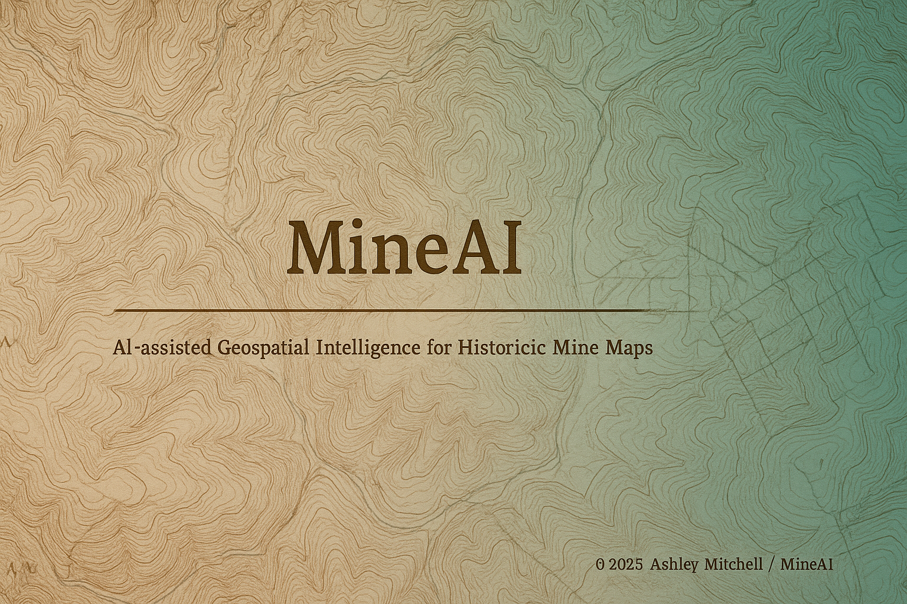

# 🪨 MineAI  
**AI-Assisted Geospatial Intelligence for Historic Mine Maps**  
*Part of the Appalachian Restoration Intelligence Ecosystem*  


---

### 🧭 Overview
**MineAI** converts historic underground mine maps into georeferenced, machine-readable spatial datasets using a pipeline of **OCR**, **deep learning (YOLOv8)**, and **AI-assisted georeferencing**.  
It transforms century-old survey sheets and scanned mylars into modern, analyzable GIS layers suitable for **AMLIS**, **OSMRE**, and **state geological survey** workflows.

MineAI is a core component of the **Appalachian Restoration Intelligence ecosystem**, complementing the [AMD Water Quality Pipeline](https://github.com/ashleyreagan/AMD_Water_Quality_Pipeline).  
Together, these tools modernize the full lifecycle of mine data — from historic cartography to present-day water-quality analytics — enabling reproducible science and cross-agency collaboration.

---

### 🔬 Methodology — How It Works

| Stage | Description |
|--------|--------------|
| **1️⃣ Ingestion & QC** | Load scanned rasters (.tif/.jpg/.png), read EXIF/DPI, and build an ingest manifest for batch tracking. |
| **2️⃣ AI-Assisted Georeferencing** | Detect alignment cues (GCPs, section lines, rivers, and topo matches) and solve affine/projective warps to USGS/NAIP basemaps. |
| **3️⃣ OCR & Layout Parsing** | Extract mine names, seam notes, T/R/S, and annotations using **Tesseract** or **TrOCR** for stylized handwriting. |
| **4️⃣ Mine Entry Detection** | **YOLOv8** identifies portal, adit, shaft, and slope symbols; detections are projected into real-world coordinates. |
| **5️⃣ Post-Processing & Export** | Clean duplicates, attach metadata, and export shapefiles or GeoJSONs. |
| **6️⃣ QA Visualization** | A built-in Streamlit dashboard previews detections, bounding boxes, and alignment accuracy for analyst review. |

---

### 🧩 Architecture

```text
                 ┌────────────┐
   Scans (.tif)  │  Ingest    │  EXIF/DPI, manifest
      ─────────► │ (ingest/)  │────────────────┐
                 └─────┬──────┘                │
                       │                       │
                       ▼                       │
                 ┌────────────┐                │
  GCPs / cues    │ Georef     │  affine/projective warp
 (optional) ───► │ (georef/)  │──────────────┐ │
                 └─────┬──────┘              │ │
                       │                     │ │
                       ├───────────────┐     │ │
                       │               │     │ │
                       ▼               ▼     ▼ ▼
                ┌───────────┐   ┌───────────┐ ┌───────────┐
                │   OCR     │   │  Detect   │ │  Streamlit│
                │ (ocr/)    │   │ (detect/) │ │  (gui/)   │
                └────┬──────┘   └────┬──────┘ └────┬──────┘
                     │              │              │
                     ▼              ▼              ▼
                 JSON text     GeoJSON boxes   QA preview
                     └──────────────┬──────────────┘
                                    ▼
                            Shapefile / GeoJSON
```

---

### 🚀 Quickstart

```bash
# 1. Create the environment
conda env create -f environment.yml
conda activate mineai

# 2. Run the full pipeline
python run_pipeline.py

# 3. Launch visualization dashboard
streamlit run src/gui/app_streamlit.py
```

**Inputs:** scanned maps (`data/raw/`)  
**Outputs:** processed shapefiles/GeoJSON (`data/final/`), detection intermediates (`data/detect/`)

---

### 🧠 Models

#### YOLOv8 — Mine Entry Detector
- Trained on annotated portal/adit/shaft/slope symbols from historic coal-field sheets.  
- Uses multi-resolution training (imgsz=640–1024) for improved small-symbol detection.  
- Fine-tuned with active learning across PA, WV, and KY mine-map archives.

Example:
```bash
yolo task=detect mode=train data=data/mine_entries.yaml model=yolov8m.pt epochs=100 imgsz=640
```

#### OCR — Tesseract / TrOCR
- Default: **Tesseract** for speed and batch reliability.  
- Optional: **TrOCR** (Microsoft Vision) for stylized or cursive handwriting.  
- Swap via `trocr_id` in `config.yaml`.

---

### 🛰️ Georeferencing Details
- **ORB / SIFT keypoints** for coarse alignment to USGS base maps.  
- **RANSAC** for outlier-robust transformation fitting.  
- Supports **affine**, **projective**, and (experimental) **thin-plate spline** warps.  
- Exports transformation matrices and RMSE reports for QA/QC.  
- Integrates with PDAL for LiDAR-based elevation normalization or terrain differencing.

---

### 🧭 Integration

| Target System | Integration Type | Description |
|----------------|-----------------|--------------|
| **ArcGIS Pro / QGIS** | Direct import | Load shapefiles/GeoJSONs for analysis or digitizing QA. |
| **OSMRE AMLIS** | Attribute harmonization | Aligns MineAI outputs with AMLIS feature codes and reclamation IDs. |
| **AMD Water Quality Pipeline** | Spatial overlay | Feeds mine-entry and discharge coordinates into AMD impact modeling. |
| **State Geological Surveys** | Repository ingest | Converts scanned mylars into vector formats for permanent GIS storage. |
| **PostGIS / AGOL** | Publishing | Optional push to enterprise geodatabases or AGOL feature services. |

---

### ⚙️ Benchmarks

| Stage | Sample Runtime (PA subset, ~100 maps) | Notes |
|--------|--------------------------------------|-------|
| Ingest & OCR | ~4 min | 12-core M3 workstation (multithreaded OCR) |
| YOLOv8 Detection | ~12 min | GPU-accelerated (RTX A5000) |
| Georeferencing | ~6 min | Parallel warp via Rasterio/GDAL |
| Total | ~22 min/map set | Full end-to-end pipeline with QA export |

---

### 🧩 Roadmap

- [ ] Multi-state training data for Central Appalachia  
- [ ] Confidence-weighted symbol clustering (YOLOv9 integration)  
- [ ] Automated map-sheet tiling and merge utilities  
- [ ] Streamlit QA annotation editor  
- [ ] Mine pool / elevation correlation using LiDAR  

---

### 💬 Citation

> **Mitchell, A. (2025).** *MineAI: AI-Assisted Geospatial Intelligence for Historic Underground Mine Maps.* GitHub.  
> [https://github.com/ashleyreagan/MineAI](https://github.com/ashleyreagan/MineAI)

---

### 🛠️ Development & Contributing
1. Fork the repository.  
2. Keep pull requests small and reproducible.  
3. Include a demo raster (≤25 MB) and output screenshot in `/tests/demo/`.  
4. Run lint/tests via `pytest`.

---

### 🪪 License
MIT © 2025 Ashley Mitchell — *Not an official DOI/OSMRE product.*

---

### 🙏 Acknowledgments
MineAI builds on the mission of **OSMRE**, **state geological surveys**, and the **Appalachian Mine Mapping community**.  
Thanks to the open-data initiatives of **PASDA**, **USGS**, and **EPA** for providing the foundational geospatial layers that make automated reclamation analysis possible.

---

### 🧠 Related Projects
- **[AMD Water Quality Pipeline](https://github.com/ashleyreagan/AMD_Water_Quality_Pipeline)** — integrates chemistry and mine data for watershed restoration analytics.  
- **MineAI Streamlit Dashboard (coming soon)** — unified QA interface for cross-state map ingestion and review.
